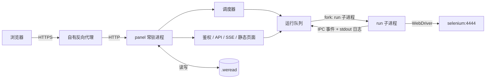
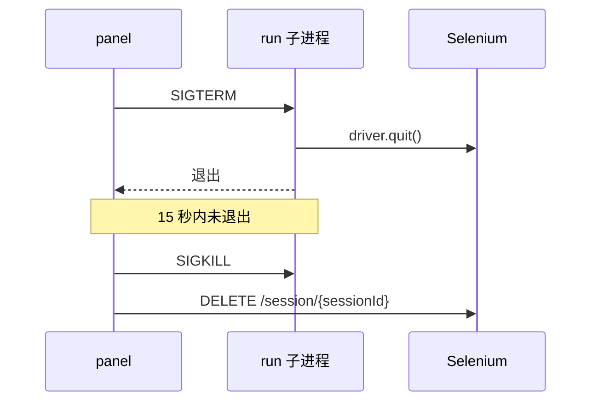

## Web 管理面板设计

> 状态：设计已确认，尚未实现。实现完成后本文转为功能说明，并补充 `cases/panel.md` 验收用例。

### 目标与范围

在现有 CLI 之外新增一个常驻的 Web 管理面板，用于多账号管理、配置编辑、调度、扫码登录和运行监控。阅读主流程保持不变，不使用面板的部署方式（`run` + crontab）继续可用。

| 范围 | 内容 |
| --- | --- |
| 包含 | 多账号；配置编辑（全局 + 账号覆盖）；面板内调度（取代宿主 crontab）；运行队列；立即运行 / 仅登录 / 停止；面板内扫码登录；实时日志与截图；运行历史；打卡日历；Selenium 状态；可选 noVNC 实时画面链接 |
| 不包含 | 读取微信读书官方数据（真实阅读时长、挑战进度）；PWA |

### 已确认的决策

| 决策 | 结论 |
| --- | --- |
| 调度归属 | 面板常驻并接管调度，删除宿主 crontab |
| 账号 | 支持多账号 |
| 前端 | Vue 3 全局构建版，免构建，依赖文件放在仓库内 |
| 访问方式 | 外网访问，经使用者自有的反向代理（Nginx / frp / Cloudflare Tunnel 等）提供 HTTPS |
| 阅读截图 | 继续每分钟截图（保留白屏检测），历史只保留最近 3 次运行的截图，可在设置中调整 |

### 架构



- 每次阅读都是一个独立的 `run` 子进程（`child_process.fork`）。现有 `run` 是"启动时读一次配置、结束时 `process.exit(0)`"的一次性流程，不在面板进程内调用 `runMain()`；Selenium 卡死或崩溃不影响面板。
- 子进程通过 IPC 事件上报状态，日志取自子进程 stdout。
- 子进程退出码恒为 0（现有 `finally` 中 `process.exit(0)`），运行结果以事件为准：退出前未收到 `done` 即判定失败。

### 职责

| 组件 | 职责 | 输入 | 输出 | 依赖 | 关键约束 |
| --- | --- | --- | --- | --- | --- |
| `panel` 子命令 | 启动常驻面板 | `PANEL_*` 环境变量或 `--port` 等参数 | HTTP 服务 | Express | 与 `run` / `schedule` 并列，不改变无参数时的兼容 `run` 行为 |
| `src/panel/auth.js` | 面板密码、会话、登录限速 | 密码、会话 cookie | 会话状态 | Node `crypto`（scrypt） | 未登录时除登录接口与静态资源外一律 401 |
| `src/panel/store.js` | `panel.json` 读写与首次迁移 | 面板数据目录 | 配置对象 | 文件系统 | 串行写入，先写临时文件再 `rename`，文件权限 `0600` |
| `src/panel/config.js` | 选项清单 → 表单 schema；全局 + 账号配置 → 子进程 env | `RUN_OPTION_SPECS`、`panel.json` | 表单 schema、env 对象 | `src/weread-challenge.js` 导出 | 密钥字段只写不读 |
| `src/panel/runner.js` | 运行队列、fork 子进程、事件处理、停止、日志落盘 | 运行请求 | 运行记录、SSE 事件 | `child_process` | 同一账号不重复排队；并发数可配 |
| `src/panel/scheduler.js` | 按账号调度规则触发运行 | 调度规则、时区 | 运行请求 | `croner` | 显式使用面板时区，不依赖容器 `TZ` |
| `src/panel/history.js` | 运行记录、每日统计、数据清理 | 运行事件 | 历史列表、打卡日历 | 文件系统 | 统计口径为本工具运行记录，非官方数据 |
| `src/panel/public/` | 前端页面 | API / SSE | 页面 | Vue 3、Pico.css、qrcode-generator | 免构建；二维码在浏览器本地生成 |

### 子进程事件

在 `src/weread-challenge.js` 中新增 `emitEvent(type, data)`：存在 `process.send` 时发送 IPC 消息，否则为空操作，不影响 CLI / cron 运行。

| 事件 | 触发点 | 字段 | 面板用途 |
| --- | --- | --- | --- |
| `started` | `runMain()` 开始 | `version` | 运行状态 → 启动中 |
| `session` | WebDriver 会话建立后 | `sessionId` | 强制停止时清理 Selenium 会话 |
| `login-required` | 解出登录链接（含二维码刷新后） | `url` | 页面显示二维码，状态 → 等待扫码 |
| `login-ok` | 登录成功 | - | 隐藏二维码 |
| `login-failed` | 登录重试耗尽 | `reason` | 运行结果 → 失败 |
| `book-opened` | 打开书籍并切换到滚动模式后 | `title` | 显示"正在读《书名》" |
| `reading-minute` | 每分钟截图时 | `minute`、`total`、`screenshot` | 进度与最新截图 |
| `done` | 阅读完成 | `minutes` | 运行结果 → 成功 |
| `error` | `catch` 分支 | `message` | 运行结果 → 失败 |

### 运行状态

| 状态 | 含义 |
| --- | --- |
| 排队中 | 已触发，等待并发槽位 |
| 启动中 | 子进程已启动，浏览器连接中 |
| 等待扫码 | 收到 `login-required`，面板显示二维码 |
| 阅读中 | 收到 `book-opened` 后，按 `reading-minute` 更新进度 |
| 成功 | 收到 `done` |
| 失败 | 收到 `error` / `login-failed`，或子进程退出前未收到 `done` |
| 已停止 | 用户在面板中停止 |
| 中断 | 面板启动时发现上次遗留的"运行中"记录 |

### 页面

| 页面 | 内容 |
| --- | --- |
| 登录 | 面板密码登录 |
| 总览 | 顶部 Selenium 状态（就绪、已用/总会话数）与运行队列；每个账号一张卡片：状态、今日已读分钟与是否达标、下次运行时间、运行 / 仅登录 / 停止按钮；需要扫码的账号置顶并直接显示二维码 |
| 账号 · 实时 | 实时日志、最新截图、二维码、"正在读《书名》第 23/68 分钟"；手机访问时提供"复制登录链接" |
| 账号 · 历史 | 运行列表（触发方式、起止时间、结果、阅读分钟）、日志查看与下载、截图回看 |
| 账号 · 打卡日历 | 按月显示每天是否有效阅读（≥ 5 分钟），今天未达标时高亮；可选填本轮挑战开始日期与类型，显示"第 N 天、已打卡 X 天、累计 Y 小时" |
| 账号 · 配置 | 每个字段可"继承全局"或"单独覆盖"；"发送测试通知"覆盖 Bark / ntfy / 邮件 |
| 账号 · 调度 | 多条规则，每条为每天固定时间 / 每 N 小时 / cron 表达式，可单独启停，显示接下来几次运行时间 |
| 全局设置 | 默认配置、并发数、时区、日志与截图保留、面板密码、noVNC 地址 |

### 数据目录与配置

```
.weread/
  panel.json              # 面板设置、全局配置、账号、调度、密码哈希（0600）
  cookies.json ...        # 旧布局原样保留，首次启动登记为账号 default
  accounts/<id>/          # 新账号的 WEREAD_DATA_DIR
    cookies.json  login.png  output.log  screenshot-*.png
  runs/<accountId>/<runId>/
    meta.json  output.log  screenshot-*.png
```

`panel.json` 结构示例：

```json
{
  "version": 1,
  "settings": {
    "timezone": "Asia/Shanghai",
    "maxConcurrentRuns": 1,
    "logRetentionDays": 30,
    "screenshotRetentionRuns": 3,
    "vncUrl": ""
  },
  "auth": { "passwordHash": "scrypt$..." },
  "defaults": {
    "WEREAD_REMOTE_BROWSER": "http://selenium:4444",
    "WEREAD_DURATION": 68
  },
  "accounts": [
    {
      "id": "default",
      "name": "默认账号",
      "enabled": true,
      "dataDir": ".",
      "overrides": { "WEREAD_SELECTION": -1 },
      "schedules": [
        { "id": "s1", "type": "daily", "times": ["06:00", "18:00"], "enabled": true }
      ],
      "challenge": { "type": "month", "startDate": "2026-10-01" }
    }
  ]
}
```

| 规则 | 说明 |
| --- | --- |
| 配置合并 | 账号覆盖 > 全局配置 > 内置默认值 |
| 面板托管字段 | `WEREAD_DATA_DIR`、`WEREAD_USER` 由面板按账号强制设置，界面不显示 |
| 环境变量导入 | 首次启动时把容器中已有的运行选项环境变量导入为全局配置；之后以面板为准，fork 时从继承的环境中剔除这些变量 |
| 账号 ID | `[a-z0-9-]`，创建后不可修改，同时用作数据目录名与 `WEREAD_USER` |
| 删除账号 | 默认保留数据目录，仅从面板移除；可勾选同时删除数据 |
| 截图归档 | 运行结束后把本次运行开始后生成的 `screenshot-*.png` 移入运行目录 |

### 调度与队列

| 规则 | 说明 |
| --- | --- |
| 时区 | 面板设置中的时区（默认 `Asia/Shanghai`），调度与按天统计都显式使用该时区 |
| 每 N 小时 | N 取 24 的约数（1/2/3/4/6/8/12），换算为 cron 表达式 |
| 并发 | 默认 1，应与 Selenium `SE_NODE_MAX_SESSIONS` 一致 |
| 重复触发 | 账号已在运行或排队时跳过本次触发并记录日志 |
| 等待扫码 | 等待扫码期间（最长 3 轮 × 5 分钟）持续占用 Selenium 槽位，其他账号排队 |
| 错过的调度 | 面板停机期间错过的调度不补跑；当天未达标在总览与日历中高亮 |
| 仅登录 | 以 `WEREAD_DURATION=0` 运行一次，用于刷新 cookies |

### 停止流程



### 打卡统计

| 项目 | 规则 |
| --- | --- |
| 当日阅读分钟 | 当天所有运行中 `reading-minute` 的累计（失败的运行也计入已读部分） |
| 有效打卡日 | 当日阅读分钟 ≥ 5 |
| 本轮进度 | 月卡：开始日起 30 日内打卡 29 天、累计 30 小时；年卡：365 日内打卡 360 天、累计 300 小时 |
| 口径说明 | 页面注明"按本工具运行记录统计，非微信读书官方数据" |

### 数据保留

| 数据 | 默认保留 | 说明 |
| --- | --- | --- |
| 运行截图 | 最近 3 次运行 | 每次约 68 张、每张 100KB 以上（小于 100KB 视为白屏），树莓派 SD 卡空间有限 |
| 运行日志 | 30 天 | |
| 运行记录（meta） | 永久 | 体积很小，打卡日历依赖它 |

### 安全

面板保存 `EMAIL_PASS`、`BARK_KEY`、`NTFY_TOKEN` 等密钥，各账号的 `cookies.json` 即微信读书登录态，且面板会暴露到外网。

| 项目 | 措施 |
| --- | --- |
| 面板密码 | 优先使用 `PANEL_PASSWORD`；未设置时首次启动随机生成并只在日志中打印一次；scrypt 哈希存储；可在界面修改（设置了 `PANEL_PASSWORD` 时以环境变量为准） |
| 登录限速 | 按 IP 连续失败 5 次后指数退避，最长 15 分钟；另设全局失败上限，防止 `X-Forwarded-For` 配置错误时被绕过 |
| 会话 | 服务端随机令牌，7 天滑动过期；cookie `HttpOnly`、`SameSite=Strict`、HTTPS 时 `Secure`、`Path` 为面板路径；修改密码后所有会话失效 |
| CSRF | `SameSite=Strict` + 修改类请求必须带自定义请求头与 JSON `Content-Type` |
| 密钥字段 | 只写不读：接口返回 `••••`，提交空值表示不修改 |
| 登录链接 | 二维码在浏览器本地生成，不经过第三方服务；仅已登录用户可见 |
| 响应头 | `X-Frame-Options: DENY`、`Referrer-Policy: no-referrer`、仅同源的 CSP |
| CSP 取舍 | Vue 3 免构建版在浏览器内编译模板，需要 `'unsafe-eval'`；所有脚本均来自仓库内文件，不加载任何第三方脚本 |
| noVNC | 默认关闭，只在设置中填写地址后显示链接；画面即已登录的浏览器，不建议经反向代理暴露 7900 端口，需要时请修改 Selenium 默认 VNC 密码并使用只读模式 |
| 使用统计 | 面板不新增任何上报，`WEREAD_AGREE_TERMS` 默认仍为 `false` |
| 额外防护 | 建议在反向代理层再加一层认证（Basic Auth / Cloudflare Access 等） |

### 反向代理

| 面板配置 | 默认值 | 说明 |
| --- | --- | --- |
| `PANEL_PORT` | `8080` | 监听端口 |
| `PANEL_HOST` | `0.0.0.0` | 监听地址（容器内） |
| `PANEL_BASE_PATH` | `/` | 部署在子路径时设置，例如 `/weread/`；前端全部使用相对路径 |
| `PANEL_TRUST_PROXY` | `false` | 设为 `true` 后信任 `X-Forwarded-For` / `X-Forwarded-Proto`，用于识别真实 IP 与 HTTPS |
| `PANEL_PASSWORD` | 空 | 面板密码 |
| `PANEL_DATA_DIR` | 同 `WEREAD_DATA_DIR` 默认规则 | 面板数据目录 |

| 注意事项 | 说明 |
| --- | --- |
| 端口映射 | 反向代理与面板在同一主机时映射为 `127.0.0.1:8080:8080`；在同一 Docker 网络时不必映射端口 |
| SSE | 实时接口响应头带 `Cache-Control: no-cache` 与 `X-Accel-Buffering: no`，每 15 秒发送心跳注释；Nginx 需对该路径设置 `proxy_buffering off` 并加大 `proxy_read_timeout` |
| 断线重连 | 前端 `EventSource` 自动重连，重连后重新拉取一次完整状态 |

### 部署

```yaml
services:
  panel:
    image: lonemoonspace/weread-challenge:latest
    command: ["node", "app.js", "panel"]
    restart: unless-stopped
    ports:
      - "127.0.0.1:8080:8080"
    environment:
      - TZ=Asia/Shanghai
      - WEREAD_REMOTE_BROWSER=http://selenium:4444   # 首次启动导入为全局默认
      - PANEL_TRUST_PROXY=true
      # - PANEL_PASSWORD=change-me
      # - PANEL_BASE_PATH=/weread/
    volumes:
      - ./.weread:/app/.weread
    depends_on:
      selenium:
        condition: service_healthy
    dns:
      - 223.5.5.5
  selenium:
    image: selenium/standalone-chromium:latest
    pull_policy: if_not_present
    restart: unless-stopped
    shm_size: 2gb
    environment:
      - SE_NODE_MAX_SESSIONS=1   # 与面板并发数一致
      - SE_ENABLE_TRACING=false
      - SE_BIND_HOST=false
      - SE_JAVA_DISABLE_HOSTNAME_VERIFICATION=false
    dns:
      - 223.5.5.5
    healthcheck:
      test: ["CMD", "curl", "-f", "http://localhost:4444/status"]
      interval: 5s
      timeout: 60s
      retries: 10
```

### 迁移

| 现有用法 | 迁移方式 |
| --- | --- |
| docker-compose + crontab | 删除 crontab 中的 `docker compose up -d` 行，换用新的 compose 文件后 `docker compose up -d`；原 `.weread/cookies.json` 自动登记为 `default` 账号，无需重新扫码 |
| docker 方式多账号 | 在面板中创建账号后，把各自的 `cookies.json` 复制到 `.weread/accounts/<id>/` |
| 不使用面板 | `run`、crontab 与 README 原有章节保持不变 |

### 对现有代码的改动

| 改动 | 说明 |
| --- | --- |
| `RUN_OPTION_SPECS` 元数据 | 补充中文名称、分组、是否密钥、可选值、默认值，面板表单由它生成 |
| `emitEvent()` | 按"子进程事件"一节埋点 |
| 优雅退出 | `run` 模式下 SIGTERM / SIGINT 先 `driver.quit()` 再退出 |
| 导出 `sendMail` | 供测试通知使用 |
| 登录重试判定 | 修复第 3 次登录成功仍被判定为失败的问题（`maxRetries--` 后计数为 0） |
| `panel` 子命令 | 加入 CLI 分发与帮助文本 |
| Dockerfile | 改为 `COPY src ./src` 并 `ln -s src/weread-challenge.js app.js`，默认 `CMD` 仍为 `node app.js`（即 `run`） |

### 新增代码结构

```
src/panel/
  server.js      # 入口：HTTP、路由、SSE、静态文件
  auth.js        # 密码、会话、登录限速
  store.js       # panel.json 读写、首次迁移
  config.js      # 选项清单 → 表单 schema；配置合并 → 子进程 env
  runner.js      # 队列、fork、事件、停止、日志落盘
  scheduler.js   # croner 封装
  history.js     # 运行记录、每日统计、清理
  public/
    index.html  app.js  style.css
    vendor/      # vue.global.prod.js、pico.min.css、qrcode-generator
scripts/panel-smoke.js
```

### 技术选型

| 部分 | 选择 | 理由 |
| --- | --- | --- |
| 后端 | Express 5 | 静态文件与请求体解析现成，避免自写路径穿越防护 |
| 前端 | Vue 3 全局构建版 + Pico.css | 免构建，arm64 镜像无需多阶段构建；页面较多时比 Alpine.js 更好组织 |
| 二维码 | qrcode-generator | 单文件，浏览器本地生成 |
| 实时 | SSE | 日志与状态只需单向推送 |
| 调度 | croner | 无依赖，支持时区 |
| 存储 | JSON 文件 | 数据量小；SQLite 的 Node 驱动在 arm64 上需要编译 |

### 开发顺序

1. 主脚本改造（"对现有代码的改动"中除 `panel` 子命令与 Dockerfile 外的各项）
2. Dockerfile、`panel` 子命令骨架、鉴权
3. 配置存储、配置合并、账号增删改查、首次迁移
4. 运行队列：fork、停止、日志、SSE
5. 调度器
6. 历史、打卡统计、数据清理
7. 前端页面
8. Selenium 状态与 noVNC 链接
9. 文档与发布：本文转为功能说明、新增 `cases/panel.md`、README 面板章节、更新 `docker-compose.yml`、版本升至 `0.21.0`

### 验证

| 方式 | 说明 |
| --- | --- |
| `scripts/panel-smoke.js` | 用桩子进程按顺序发送事件，不需要浏览器即可验证队列、停止、历史、统计与鉴权；通过 `npm run test:panel` 执行 |
| 现有 smoke | `npm run test:notify`、`npm run test:runtime` 继续通过，确认 CLI 与镜像入口未受影响 |
| 真机验收 | 在树莓派上以 compose 部署，经反向代理访问，完成扫码、阅读、停止、调度触发各一次 |
